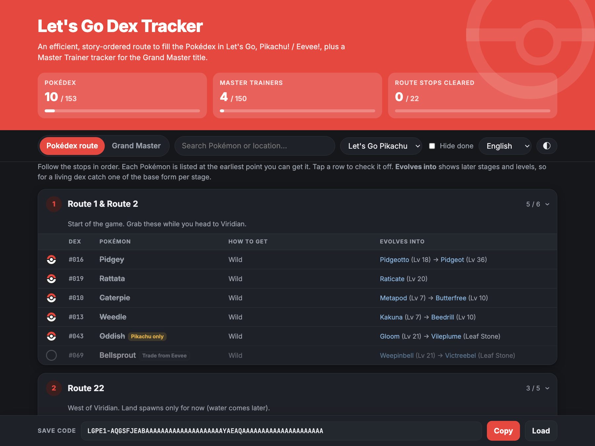

# Let's Go Dex Tracker

A free, single-page tracker for **Pokémon: Let's Go, Pikachu! / Let's Go, Eevee!**

**▶ Use it here:** https://mostafarlotfi.github.io/letsgo-dex-tracker/

## Features

- **Story-ordered Pokédex route.** All 153 entries (#001–151 plus Meltan and Melmetal) are grouped into 22 stops. Each Pokémon is listed at the earliest point you can get it.
- **Evolution chains with levels** for every Pokémon, which helps if you're building a living dex.
- **Grand Master tracker.** All 153 Master Trainers with their locations, sortable by dex number or location, with the CP requirement shown for the trainers who don't battle.
- **Version-aware.** Pick Pikachu or Eevee and the other version's exclusives are labeled "Trade from…".
- **Your languages.** Switch the whole page, including the official Pokémon names, to 日本語, Français, Deutsch, 한국어, 繁體中文 or 简体中文. Search works in the chosen language and in English.
- **No account needed.** Your progress lives in a save code at the bottom of the page (see below).
- Search, hide finished entries, light/dark mode, and a layout that works on a phone.

## Saving your progress

The bar at the bottom of the page shows a **save code** that looks like `LGPE1-AQGSFJEA…`. It holds everything you've checked off on both tabs, plus your game version, and it updates every time you tick a box.

1. Tap **Copy** and paste the code into a notes app on your phone or computer (Apple Notes, Google Keep, anything).
2. To pick up where you left off, on any device or browser, open the page, tap **Load**, paste the code and tap **Restore**.

The page also remembers your progress in the browser you're using, but that copy is lost if you clear your browser data or switch devices. The code in your notes is your backup, so copy it again after each play session.

## Sources

Locations were cross-checked from [Thonky](https://www.thonky.com/pokemon-lets-go/list-of-pokemon-locations) and [PokéCommunity Daily](https://daily.pokecommunity.com/2018/11/16/pokemon-lets-go-pikachu-and-eevee-dex-locations-and-more/). Master Trainer data comes from [Bulbapedia](https://bulbapedia.bulbagarden.net/wiki/Master_Trainer), [SuperCheats](https://www.supercheats.com/lets-go-pikachu/walkthrough/where-are-all-the-master-trainers) and [GamerGuides](https://gamerguides.com/pokemon-lets-go-pikachu-and-lets-go-eevee/guide/postgame/master-trainers). Localized Pokémon and item names come from [PokeAPI](https://pokeapi.co/).

Spot an error? Open an issue.

*Fan-made project, not affiliated with Nintendo, Game Freak, Creatures Inc. or The Pokémon Company.*
